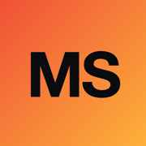

<div align="center">
  

  # Maneet Srivastav
  ### Mobile Application Engineer | iOS Expert | React Enthusiast

  <p align="center">
    <a href="https://app.netlify.com/projects/maneet-srivastav/deploys">
      
    </a>
    
    
    
  </p>

  <p align="center">
    <a href="https://maneet-srivastav.netlify.app">View Live Portfolio</a>
    ·
    <a href="https://github.com/ManeetSri/ManeetSri.github.io/issues">Report Bug</a>
    ·
    <a href="https://github.com/ManeetSri/ManeetSri.github.io/issues">Request Feature</a>
  </p>
</div>

<br />

## 🚀 About The Project

This is my personal portfolio website, built like an iPhone app being compiled and run. Built with **React**, **Tailwind CSS** and **Framer Motion**, it tells the story of my work as you scroll.

### ✨ Key Features

-   **🔨 Xcode-style loader**: Compiles my career, then morphs into the phone's Dynamic Island.
-   **📱 Scroll-driven phone**: One pinned phone unlocks, shows my version history and opens each app.
-   **🌍 Live demo**: A working web recreation of my CountryPicker Swift Package.
-   **📈 Instruments-style skills**: Each skill is plotted against the roles where I used it.
-   **♿ Reduced motion support**: Every scene falls back to a complete static layout.
-   **📝 Contact Form**: A Messages-style form integrated with **Netlify Forms**.
-   **✍️ Blog Integration**: Displays my latest Medium articles as a git log.

## 🛠️ Built With

*   [](https://reactjs.org/)
*   [](https://vitejs.dev/)
*   [](https://tailwindcss.com/)
*   [](https://www.netlify.com/)
*   [](https://lucide.dev/)

## 🏁 Getting Started

To get a local copy up and running, follow these simple steps.

### Prerequisites

*   npm
    ```sh
    npm install npm@latest -g
    ```

### Installation

1.  Clone the repo
    ```sh
    git clone https://github.com/ManeetSri/ManeetSri.github.io.git
    ```
2.  Install NPM packages
    ```sh
    npm install
    ```
3.  Start the development server
    ```sh
    npm run dev
    ```

## 📬 Contact

**Maneet Srivastav**

[](mailto:srivastavmaneet@gmail.com)
[](https://www.linkedin.com/in/maneet-srivastav-1499a1196/)
[](https://github.com/ManeetSri)
[](https://medium.com/@maneetsrivastav)

---

<div align="center">
    <p>Designed & Built with ❤️ by Maneet Srivastav</p>
</div>
